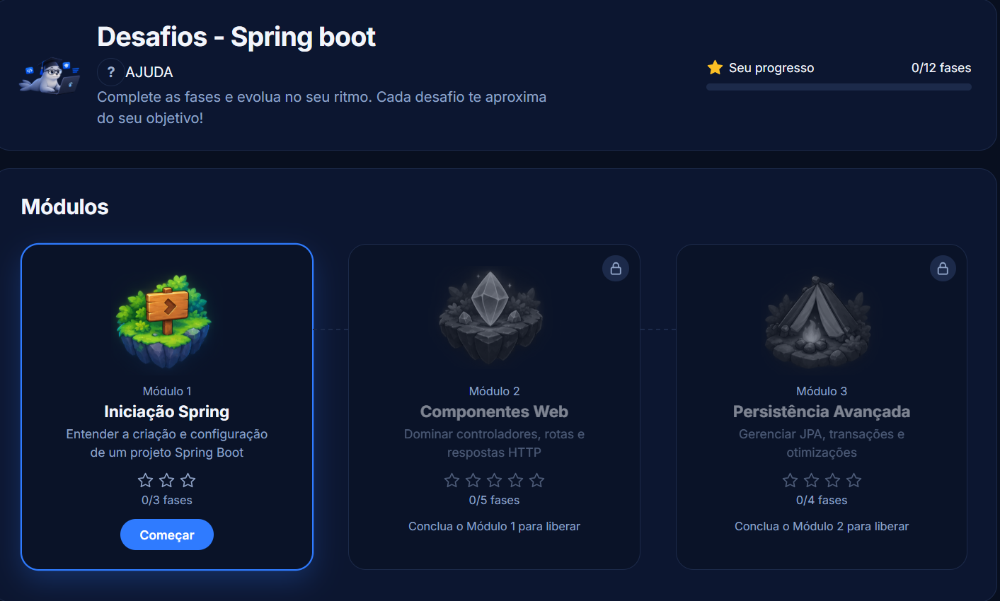
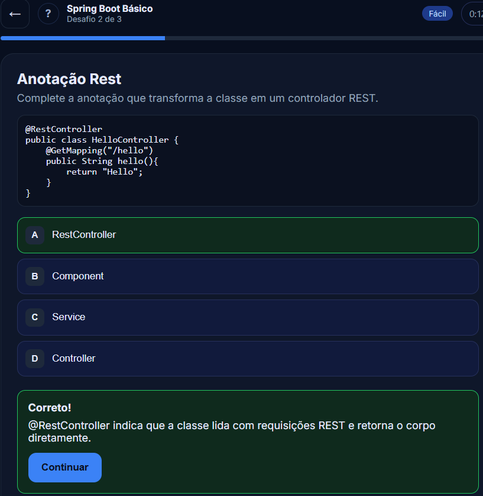

# FocaLearn

> Digite qualquer assunto e estude com desafios gerados por IA, organizados em módulos que sobem de dificuldade.

- Tela desafios, contém todos os módulos gerados:



- Tela Sessão, contém todos os desafios gerados:



## Sobre

O FocaLearn é uma plataforma de estudo guiada por IA. O aluno escolhe um assunto (Java, SQL, Spring Boot, matemática...), e a aplicação monta uma **trilha de desafios** sob medida, dividida em módulos do fácil ao difícil. Não é preciso criar conta: basta informar um apelido.

## Funcionalidades

- **Trilha gerada por IA** para qualquer assunto, em módulos por dificuldade (fácil, médio e difícil).
- **5 formatos de desafio:** múltipla escolha, complete o código, ordene o código, cace o bug e central de investigação.
- **Progresso por módulo:** o módulo conclui ao responder todas as fases (acertando ou errando) e libera o próximo. As estrelas mostram quantas fases foram acertadas, e as erradas podem ser refeitas.
- **Ranking** por acertos e tempo, identificado só pelo apelido.
- **Universo de conhecimento:** cada assunto estudado vira um "sistema solar".
- **Dicas contextuais** que aparecem na primeira vez de cada tela ou formato, e podem ser reabertas pelo botão "?".
- **Sem cadastro:** apelido e progresso ficam salvos no navegador.

## Como funciona

1. O aluno informa um apelido e pesquisa um assunto no painel.
2. O backend pede os desafios à IA (Groq, com Gemini como reserva), valida cada um, repara o que for possível e embaralha as alternativas.
3. O front agrupa os desafios agrupando por dificuldade.
4. A Sessão apresenta uma fase por vez, com cronômetro que pausa durante as dicas.

## Tecnologias

| Camada   | Tecnologias                                              |
|----------|----------------------------------------------------------|
| Frontend | Angular (componentes standalone, signals), TypeScript, CSS |
| Backend  | Java, Spring Boot, Jackson                               |
| IA       | Groq (principal) e Google Gemini (fallback)              |

## Pré-requisitos

- Node.js (versão LTS) e npm
- Java 21 ou superior
- Uma chave de API da [Groq](https://console.groq.com) e/ou do [Google AI Studio](https://aistudio.google.com)

## Configuração

As chaves **nunca** ficam no repositório. O `application.properties` lê variáveis de ambiente:

| Variável           | Descrição                  |
|--------------------|----------------------------|
| `GROQ_API_KEY`     | Chave da API da Groq       |
| `GOOGLEAI_API_KEY` | Chave da API do Google AI  |

Defina as variáveis antes de rodar o backend.

**PowerShell (Windows):**

```powershell
$env:GROQ_API_KEY = "sua-chave"
$env:GOOGLEAI_API_KEY = "sua-chave"
```

**Linux / macOS:**

```bash
export GROQ_API_KEY="sua-chave"
export GOOGLEAI_API_KEY="sua-chave"
```

Na IDE (IntelliJ), use *Run Configuration → Environment variables*. O arquivo `backend/src/main/resources/application.properties.example` mostra todas as propriedades usadas.

## Como rodar

**Backend** (porta 8080):

```bash
cd backend
./mvnw spring-boot:run        # ou ./gradlew bootRun, conforme o seu build
```

**Frontend** (porta 4200):

```bash
cd frontend
npm install
npm start                      # ou: ng serve
```

Abra http://localhost:4200.

## Estrutura

```
focalearn/
├── frontend/                  # Angular
│   └── src/app/
│       ├── pages/             # home, dashboard, desafios, sessão...
│       ├── core/services/     # assistant, trilha, ranking, dicas
├── backend/                   # Spring Boot
│   └── src/main/java/...      # controller, AssistantService (IA e validação)
└── README.md
```

## API

| Método | Rota                  | Parâmetro | Descrição                                   |
|--------|-----------------------|-----------|---------------------------------------------|
| POST   | `/assistant/desafios` | `assunto` | Gera os desafios do assunto (JSON validado) |

## Decisões de projeto

- **Validação no backend:** a IA erra formato com frequência (campos faltando, linhas coladas, correção igual ao erro). Cada desafio é reparado e validado antes de chegar ao aluno.
- **Fallback entre provedores:** se a Groq falha ou atinge o limite, a requisição segue para o Gemini.
- **Progresso derivado:** o status dos módulos (ativo, concluído, bloqueado) nunca é gravado, só calculado a partir das fases respondidas, o que evita estados inconsistentes.

## Próximos passos

- [ ] Mover a URL da API para `environment.ts`
- [ ] Persistir trilhas e ranking no servidor
- [ ] Várias trilhas por aluno
- [ ] Testes automatizados

## Autor

Feito por **João Vitor Pinto da Silva** — [LinkedIn](www.linkedin.com/in/devjoaovitorr) · [GitHub]https://github.com/joaodev-java)

## Licença

Defina uma licença (por exemplo MIT) ou remova esta seção.